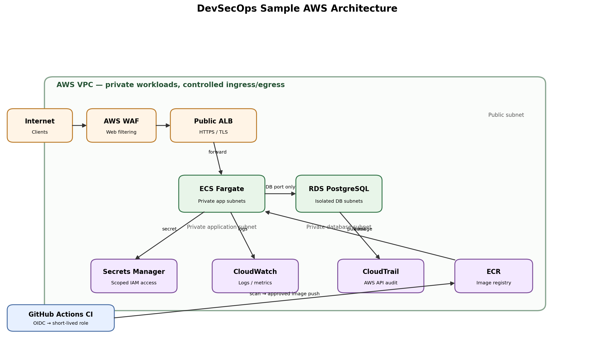

# DevSecOps Engineer Home Test - Secure AWS & CI/CD Pipeline

A complete, production-grade DevSecOps implementation demonstrating secure containerized API development, automated Shift-Left security gates (SAST, SCA, Secret Scanning, IaC, Container Scan, DAST), and hardened AWS ECS Fargate & RDS infrastructure provisioned via Terraform.

---

## 1. Executive Summary & Architecture Overview

The system deploys a containerized Go REST API onto **AWS ECS with AWS Fargate**, fronted by an internet-facing **Application Load Balancer (ALB)** protected by **AWS WAFv2**, with an isolated **Amazon RDS PostgreSQL** database and centralized secret management via **AWS Secrets Manager**.



### 1.1 Request Flow from Internet to Application (Task 1 - Req 1)
1. **DNS & Edge Protection**: Client initiates an HTTPS request to the API domain. DNS routes to the public ALB.
2. **AWS WAF Inspection**: Before reaching the ALB listener, incoming traffic is evaluated by **AWS WAFv2** applying the `AWSManagedRulesCommonRuleSet` (mitigating OWASP Top 10 web exploits, SQLi, and bad bots).
3. **ALB & TLS Termination**: 
   - Port 80 (HTTP) automatically redirects via HTTP 301 to Port 443 (HTTPS).
   - Port 443 terminates TLS using a modern, secure cipher suite (`ELBSecurityPolicy-TLS13-1-2-2021-06`) and drops invalid HTTP headers (`drop_invalid_header_fields = true`).
4. **Target Group & Ingress Routing**: ALB forwards requests over HTTP to the private ECS tasks on port `8080`. Security Group rules strictly allow ingress to ECS tasks *only* from the ALB Security Group ID.
5. **ECS Fargate Task Execution**: Tasks run in private application subnets without public IPs. The Go application executes inside a minimal, distroless, non-root container with a read-only root filesystem.
6. **Isolated Database Access**: Application tasks connect to Amazon RDS PostgreSQL on port `5432`. The database resides in isolated private subnets with no internet gateway route. RDS Security Group allows ingress *only* from the ECS Security Group.
7. **Secrets & Telemetry**:
   - The ECS Container Agent injects secrets into task memory via **AWS Secrets Manager** during startup using the **ECS Task Execution Role**.
   - Container logs are streamed securely to **Amazon CloudWatch Logs**.
   - All management events and AWS API interactions are audited by **AWS CloudTrail**.

---

### 1.2 Public vs. Private Resources (Task 1 - Req 2)

| Resource | Placement | Accessibility | Security Rationale |
|---|---|---|---|
| **Application Load Balancer (ALB)** | Public Subnets (2 AZs) | Public (0.0.0.0/0 on ports 80, 443) | Single controlled public ingress point. Protected by AWS WAF and TLS termination. |
| **NAT Gateway** | Public Subnet 1 | Outbound Internet Egress | Provides outbound internet access for private tasks (ECR pull, CloudWatch, OS updates) without allowing inbound traffic. |
| **Internet Gateway (IGW)** | VPC Border | AWS Edge | Enables internet routing for ALB and NAT Gateway only. |
| **ECS Fargate Tasks** | Private App Subnets (2 AZs) | Private (`assign_public_ip = false`) | Isolated from direct internet attacks; ingress strictly restricted to ALB Security Group. |
| **Amazon RDS PostgreSQL** | Isolated DB Subnets (2 AZs) | Completely Isolated (No IGW/NAT route) | Zero inbound/outbound internet access. Ingress restricted to ECS tasks on port 5432. |
| **AWS Secrets Manager / KMS** | AWS Managed VPC / PrivateLink | Private Endpoint / NAT | Encrypted credential storage accessible only via IAM-authenticated API calls. |

---

### 1.3 How Application Retrieves Secrets Without Hardcoding (Task 1 - Req 3)

The architecture supports two complementary patterns:

1. **ECS Task Definition Secret Injection (Implemented in Terraform)**:
   - Secret credentials (username, password, db name) are generated and stored in **AWS Secrets Manager**.
   - The ECS Task Definition references the secret ARN in its `secrets` container definition block:
     ```json
     "secrets": [{ "name": "DB_SECRET", "valueFrom": "${aws_secretsmanager_secret.db_credentials.arn}" }]
     ```
   - At container launch, the **ECS Container Agent** assumes the **Task Execution Role**, invokes `secretsmanager:GetSecretValue`, and injects the decrypted secret as an in-memory environment variable into the container.
   - **Zero Hardcoding**: Credentials never appear in Git repositories, Dockerfile layers, or task definition plaintext.
2. **Runtime SDK Retrieval with Automatic Rotation (Task Role Pattern)**:
   - For applications requiring dynamic secret rotation without restarting containers, the application code assumes the **Task Role** at runtime using the AWS SDK (`secretsmanager:GetSecretValue`) and caches the secret in-memory with a short TTL.

---

### 1.4 IAM Roles: CI/CD Pipeline vs. Application Runtime (Task 1 - Req 4)

| Role Type | Principal / Identity | Primary Permissions (Least Privilege) | Security Boundary |
|---|---|---|---|
| **CI/CD Deployment Role** | GitHub Actions / GitLab CI via **OIDC Federation** (No static keys) | `ecr:GetAuthorizationToken`, `ecr:PutImage`, `ecs:UpdateService`, `ecs:RegisterTaskDefinition`, `iam:PassRole` | Restricted strictly to the specific repository, branch (`main`), and protected GitHub environment (`production`). |
| **ECS Task Execution Role** | `ecs-tasks.amazonaws.com` (ECS Agent) | `ecr:GetDownloadUrlForLayer`, `ecr:BatchGetImage`, `logs:CreateLogStream`, `logs:PutLogEvents`, `secretsmanager:GetSecretValue` on specific secret ARN. | Used *only by the ECS Agent* to bootstrap the container. Container application processes cannot access this role. |
| **ECS Task Role** | `ecs-tasks.amazonaws.com` (Application Container) | Minimal or empty by default (`aws_iam_role.task`). If needed: S3 bucket read/write, KMS decrypt, DynamoDB query. | Used *by the application code* during runtime. Prevents application exploits from compromising infrastructure management. |

---

### 1.5 Preventing Unauthorized Access to Production (Task 1 - Req 5)

1. **Identity & Credential Governance**:
   - Zero long-lived AWS Access Keys (`AWS_ACCESS_KEY_ID`). All CI/CD deployments authenticate via **OIDC with short-lived STS tokens** (15–60 min expiry).
   - Multi-Factor Authentication (MFA) and AWS IAM Identity Center (SSO) required for human access.
   - Break-glass emergency access requires peer review and triggers instant CloudWatch alarms.
2. **Network Segmentation & Defense-in-Depth**:
   - 3-tier VPC architecture (Public, Private App, Isolated DB).
   - Strict Security Group chaining: ALB SG -> ECS Task SG -> RDS SG.
   - Database has zero route table access to the Internet Gateway.
3. **Deployment Gates & Approvals**:
   - Production releases require manual approval in GitHub Protected Environments.
   - CI pipeline fails automatically if any security gate (SAST, SCA, Secrets, IaC, Container) detects High/Critical vulnerabilities.
4. **Data Protection & Encryption**:
   - TLS 1.3 in transit.
   - AWS KMS encryption at rest across RDS, ECR, CloudWatch, and Secrets Manager.
5. **Continuous Audit & Monitoring**:
   - AWS CloudTrail records all management API activity across all regions.
   - VPC Flow Logs capture network accept/reject trends.

---

### 1.6 Five Key Security Risks & Corresponding Mitigations (Task 1 - Req 6)

| # | Threat / Security Risk | Potential Impact | DevSecOps Mitigation Implemented |
|---|---|---|---|
| **1** | **Accidental Secret Leakage in Git or Container Images** | Exposure of database passwords or AWS credentials to unauthorized users. | **Gitleaks** scans every commit in CI/CD. Multi-stage Dockerfile avoids secrets in layers. Secrets injected via **AWS Secrets Manager** at runtime. |
| **2** | **Overprivileged IAM Roles / CI/CD Credential Compromise** | An attacker exploiting CI runner obtains full AWS Administrator access. | Short-lived **AWS OIDC credentials** with strict `sub` claim. Scoped IAM policies with resource-level ARNs. Separation of deployment, execution, and task roles. |
| **3** | **Public Exposure of Database or Backend APIs** | Direct internet connection to database leading to ransomware or data exfiltration. | RDS in **Isolated Subnets** (`publicly_accessible = false`). Security groups strictly restrict port 5432 to ECS task SG. **Checkov rule `CKV_AWS_17` & `CKV_AWS_260`** block misconfigurations in CI. |
| **4** | **Vulnerable Base Images & Supply Chain Attacks** | Known CVEs in OS libraries allowing Remote Code Execution (RCE) in container. | Multi-stage build using **Google Distroless non-root** image (zero package managers, no shell). **Trivy Image Scan** blocks builds with Critical/High CVEs. |
| **5** | **Application-Layer Exploits (OWASP Top 10 - SQLi, XSS, DoS)** | Injection attacks bypassing network firewalls and compromising the backend. | **AWS WAFv2** on ALB inspecting incoming traffic. **Semgrep SAST** and **OWASP ZAP DAST** automated in pipeline. Read-only root filesystem on ECS tasks. |

---

## 2. CI/CD Security Pipeline & Security Gates (Task 2)

The CI/CD pipeline runs on **GitHub Actions** (`.github/workflows/devsecops.yml`) and is also mirrored for **GitLab CI/CD** (`.gitlab-ci.yml`).

```
[ Git Push / PR ]
       │
       ▼
 1. Source Validation ──► [ gofmt | go test | go vet ]
       │
       ▼
 2. Secret Scanning   ──► [ Gitleaks (Fail on leak) ]
       │
       ▼
 3. SAST              ──► [ Semgrep (Fail on vulnerability) ]
       │
       ▼
 4. SCA / Deps Scan   ──► [ Trivy Filesystem (Fail on High/Crit CVE) ]
       │
       ▼
 5. IaC Security Scan ──► [ Checkov Terraform (Fail on non-compliance) ]
       │
       ▼
 6. Container Build   ──► [ Multi-stage Docker Build (Distroless non-root) ]
       │
       ▼
 7. Container Scan    ──► [ Trivy Image Scan (Fail on High/Crit CVE) ]
       │
       ▼
 8. DAST Scan         ──► [ OWASP ZAP Baseline Scan against Ephemeral API ]
       │
       ▼
 9. Deploy Gate       ──► [ Protected Environment Manual Approval + OIDC Deploy ]
```

### 2.1 Security Gate Matrix

| Stage | Tool | Blocking Policy (Exit Code 1) | Artifact Generated |
|---|---|---|---|
| **Source Validation** | `gofmt`, `go test`, `go vet` | Any test failure, formatting diff, or vet error | Unit test execution logs |
| **Secret Scanning** | Gitleaks v8 | Any leaked secret, key, or token | `gitleaks-report.json` |
| **SAST** | Semgrep v1 | Any High / Critical rule finding | `semgrep.sarif` |
| **SCA** | Trivy Filesystem v0.58 | Unfixed Critical or High CVEs in dependencies | `trivy-fs-report.json` |
| **IaC Scanning** | Checkov v3 | Any failed CIS AWS Benchmark or security check | `checkov-report.json` |
| **Container Scan** | Trivy Image v0.58 | Unfixed Critical or High CVEs in image layers | `trivy-image-report.json` |
| **DAST** | OWASP ZAP Baseline | High/Critical alerts (SQLi, XSS, RCE, Broken Auth) | `zap-report.html` |
| **Deploy Gate** | GitHub Environment | Requires manual peer review & approval | Audit trail in GitHub & AWS CloudTrail |

See [`evidence/scan-results.md`](evidence/scan-results.md) for actual scan outputs and execution evidence.

---

## 3. Repository Structure

```text
devsecops-home-test/
├── README.md                          # Comprehensive documentation & architecture guide
├── .gitlab-ci.yml                     # Complete GitLab CI/CD pipeline configuration
├── .dockerignore                      # Docker context exclusion rules
├── .gitignore                         # Git exclusion rules
├── .github/
│   └── workflows/
│       └── devsecops.yml              # GitHub Actions DevSecOps workflow with security gates
├── app/
│   ├── Dockerfile                     # Multi-stage, distroless, non-root hardened Dockerfile
│   ├── go.mod                         # Go module definition
│   └── src/
│       ├── main.go                    # REST API with security headers & healthcheck
│       └── main_test.go               # Unit tests & security header verification
├── architecture/
│   └── architecture-diagram.png       # 3-Tier secure AWS architecture diagram
├── terraform/
│   ├── main.tf                        # Caller identity, AWS data sources, common tags
│   ├── versions.tf                    # Terraform & AWS provider requirements
│   ├── variables.tf                   # Input variables & CIDR definitions
│   ├── outputs.tf                     # ECR, ECS, ALB, and RDS outputs
│   ├── networking.tf                  # VPC, 3-tier subnets, IGW, NAT Gateway, route tables
│   ├── security.tf                    # ALB, ECS, RDS Security Groups & AWS WAFv2 Web ACL
│   ├── iam.tf                         # Least-privilege Task Execution Role & Task Role
│   ├── ecs.tf                         # ALB, HTTPS listeners, ECR, CloudWatch, ECS Fargate service
│   └── database.tf                    # Encrypted RDS PostgreSQL & Secrets Manager credentials
├── security/
│   ├── vulnerability-policy.md        # Severity SLAs, unpatched CVE handling & exception framework
│   ├── incident-response.md           # Troubleshooting & runbook for 3 production incident scenarios
│   ├── scenarios-remediation.md       # Detailed answers & remediation for Task 3 Scenarios A, B, C
│   └── dast-owasp.md                  # Task 6 DAST methodology & OWASP Top 10 mitigation guide
└── evidence/
    └── scan-results.md                # Full execution evidence & scan outputs for all tools
```

---

## 4. Local Execution & Validation Instructions

### 4.1 Test & Run the Backend Application Locally
Prerequisites: Go 1.23+, Docker.

```bash
# 1. Run unit tests and static checks
cd app
go test -v ./...
go vet ./...
test -z "$(gofmt -l src)"

# 2. Build and run hardened container
docker build -t devsecops-home-test:local .
docker run --rm -d -p 8080:8080 --name sample-api devsecops-home-test:local

# 3. Test endpoints
curl -i http://localhost:8080/health
curl -i http://localhost:8080/

# Cleanup
docker stop sample-api
cd ..
```

### 4.2 Run Security Scans Locally
```bash
# Secret scanning
gitleaks detect --source . --verbose --redact --no-git

# SCA / Filesystem vulnerability scan
trivy fs --scanners vuln,misconfig,secret --severity HIGH,CRITICAL .

# Terraform IaC security scan
checkov -d terraform/ --framework terraform --soft-fail false

# Container image vulnerability scan
trivy image --severity HIGH,CRITICAL --ignore-unfixed devsecops-home-test:local

# DAST Baseline scan (run against authorized local container)
docker run --rm --network host ghcr.io/zaproxy/zaproxy:stable \
  zap-baseline.py -t http://127.0.0.1:8080 -r zap-report.html
```

### 4.3 Validate Terraform Configuration
```bash
cd terraform
terraform fmt -check -recursive
terraform init
terraform validate
# Plan requires an ACM certificate ARN for the HTTPS listener:
terraform plan -var="acm_certificate_arn=arn:aws:acm:ap-southeast-1:123456789012:certificate/example-cert-id"
```

---

## 5. Security Scenarios & Runbooks Summary

Detailed documentation for interview scenarios is maintained in dedicated runbooks:

1. **[Task 3 - Mandatory Security Scenarios](security/scenarios-remediation.md)**:
   - **Scenario A (Overly Permissive IAM)**: Risks of `Action: "*", Resource: "*"`, least-privilege deployment role design, short-lived OIDC credentials, and cross-account access patterns.
   - **Scenario B (Publicly Accessible Database `0.0.0.0/0`)**: Shift-Left prevention via Checkov `CKV_AWS_17`/`CKV_AWS_260`, OPA policy gates, isolated subnet topology, and AWS Config guardrails.
   - **Scenario C (Secret Exposure in State File)**: Immediate credential rotation, Git history cleansing with `git-filter-repo`, remote state S3 encryption, and AWS RDS `manage_master_user_password = true` native integration.
2. **[Task 5 - Troubleshooting & Incident Response](security/incident-response.md)**:
   - **Scenario A (Pipeline Security Failure)**: Handling developer bypass requests for critical CVEs, reachability analysis, compensating WAF controls, and formal CISO sign-off.
   - **Scenario B (ECS Secrets Manager Retrieval Failure)**: Root cause analysis of Task Execution Role vs. Task Role, KMS decrypt permissions, VPC Endpoint / NAT connectivity, and least-privilege troubleshooting.
   - **Scenario C (Unauthorized CI API Activity)**: Immediate containment via STS session invalidation and role trust freezing, CloudTrail Athena forensics, and OIDC subject claim tightening.
3. **[Task 6 - DAST & OWASP Top 10](security/dast-owasp.md)**:
   - Safe test environment provisioning, automated passive/active checks, JWT authentication handling, release gates, and deep mitigation for Broken Access Control (A01), Injection (A03), and Security Misconfiguration (A05).
4. **[Vulnerability Management Policy](security/vulnerability-policy.md)**:
   - Severity SLAs, handling unpatched critical vulnerabilities, risk acceptance documentation, and false positive suppression workflows.

---

## 6. Known Limitations & Remaining Risks

1. **Local Demo vs. Production KMS**: In this minimal demonstration, AWS-managed encryption keys are used for RDS and ECR by default. For high-compliance production workloads, Customer Managed Keys (CMKs) with independent KMS key policies and automatic key rotation should be configured.
2. **Single NAT Gateway**: A single NAT Gateway is provisioned in AZ-1 to balance cost and complexity for the demo. In a high-availability production architecture, one NAT Gateway per Availability Zone should be deployed to avoid cross-AZ single points of failure.
3. **Sample API Scope**: The sample Go backend provides a minimal, hardened HTTP service (`/` and `/health`) with security headers. Real-world business logic would introduce database ORM models and JWT middleware.
4. **Terraform Remote Backend**: Remote state storage (`backend "s3"`) is deliberately omitted to prevent account lock-in for local evaluation. Production must utilize an encrypted S3 bucket with DynamoDB state locking.
